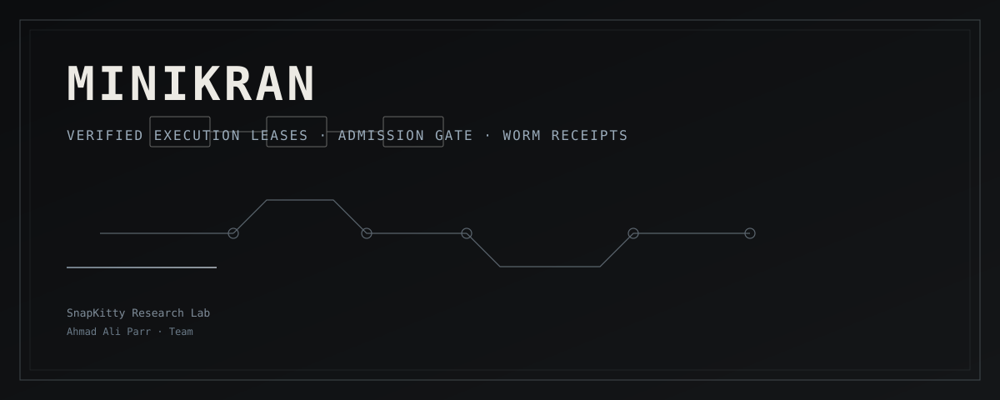
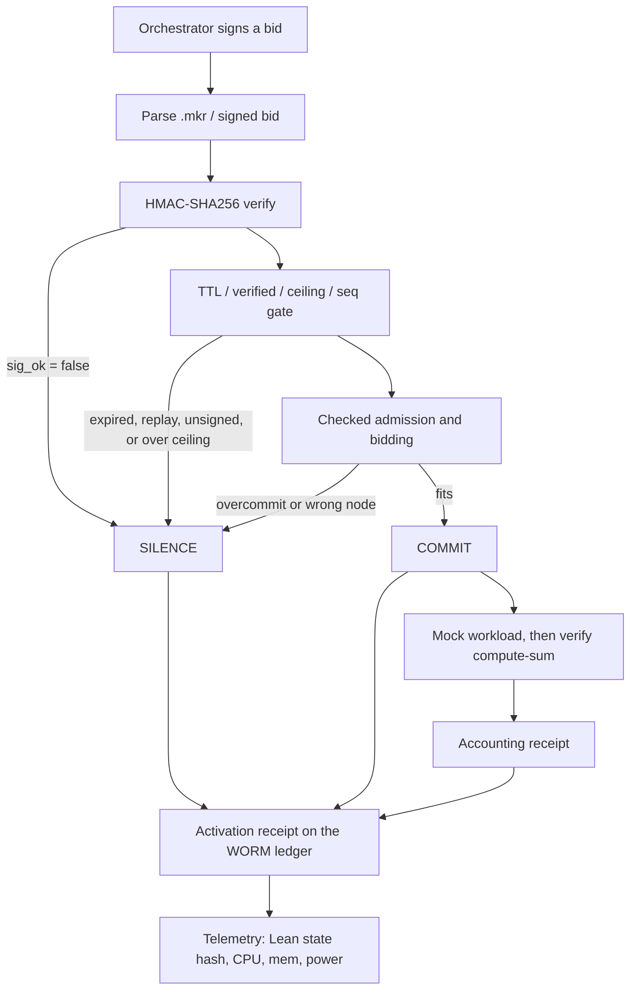

<p align="center">
  
</p>

# Minikran

**Verified execution leases, admission control, and hash-chained receipts.**

Minikran is a formal-verification stack for resource-bounded workload admission: Lean 4 proofs of lease validity and gate behavior, Soufflé Datalog admission policy, a Rust node that parses `.mkr` specs and appends WORM ledger receipts, and Kani checks that the gate never commits expired, unsigned, or replayed leases.

Authored by **Ahmad Ali Parr** and Team · [SnapKitty Research Lab](https://github.com/AHMADALIPARR)

[](https://github.com/AHMADALIPARR/Minikran/actions/workflows/ci.yml)
[](https://github.com/AHMADALIPARR/Minikran/actions/workflows/eval.yml)
[](lean-toolchain)
[](LICENSE)

The numbers in this README are from the logs under [`docs/measurements/`](docs/measurements/), recorded on 12 November 2026 (America/Los_Angeles). They are not estimates.

---

## What it does

| Layer | Role |
|-------|------|
| **Lean 4** | `Lease` and timed leases under the `Minikran` namespace. Theorems: invalid/expired/unsigned → `SILENCE`; replay rejected; accepted sequence numbers strictly increase; `COMMIT` implies every check passed. No `sorry`, no custom axioms. |
| **Datalog** | Soufflé admission rules. `minikran_admission.dl` is the naive policy; `minikran_admission_checked.dl` is the real gate (priority order, remaining capacity, one node per task, no overflow). |
| **Rust** | Parses `.mkr`, runs the signed-lease gate, writes hash-chained WORM receipts, exposes telemetry (CPU / memory / power when available). |
| **Kani** | Symbolic proofs that the gate never commits an expired, unsigned, or replayed lease; sequence monotonicity and ledger linkage. |
| **`.mkr`** | Custom lease syntax, indexed as Minikran language via Linguist + TextMate grammar. |

Hardware root of trust is documented as a future integration point at the cloud-to-node handoff boundary. See [docs/handoff-boundary.md](docs/handoff-boundary.md).

The repository has two Rust surfaces and two Lean surfaces, on purpose:

- [`rust/`](rust/) and [`Minikran/`](Minikran/) are the original node skeleton and the Lean library on `main`.
- [`node/`](node/) and [`MinikranProofs/`](MinikranProofs/) are the fuller eval crate and the 21 additional theorems. They do not replace the files above.

---

## Architecture

A signed request is checked, admitted, optionally dispatched, and then written to a hash-chained ledger. Telemetry reads that ledger back, together with whatever counters the machine actually exposes.



On `COMMIT` the node appends an activation receipt, runs the workload, checks the result independently (`verify compute-sum ok`), and appends an accounting receipt with the child's real `wait4(2)` rusage. Power is included only when RAPL or an INA-style hwmon is readable; otherwise telemetry reports `power: null`. Every walk of the ledger starts at genesis and will catch a byte flip, a deleted or reordered entry, or a pruned tail.

---

## `.mkr` syntax

A lease file is a named block plus optional `assert` lines. The production example in the repo is [`example.mkr`](example.mkr):

```mkr
# Minikran Resource Spec (.mkr)
# Custom syntax for Minikran leases and verification state

lease production {
  cpu: 16
  mem: 32
  store: 100
  power: 50
  verified: true
}

assert production.within_ceiling
assert production.verified
```

`cpu`, `mem`, `store`, and `power` are the resource ceilings. `verified` is the logical/cryptographic flag on the lease. The asserts are the same checks as `within_ceiling` and `lease_is_verified` in Lean. Highlighting for `.mkr` lives in the [TextMate grammar](grammars/minikran.tmLanguage.json) and the [VS Code extension](editors/vscode/).

---

## Lean 4

Toolchain and Mathlib are pinned to [`v4.36.0-rc2`](lean-toolchain). The library namespace is `Minikran`.

### Base library

[`Minikran/Lease.lean`](Minikran/Lease.lean) defines the `Lease` structure (`cpu`, `mem`, `store`, `power`, `verified`) and `productionLease`. Two theorems sit on that baseline:

| Theorem | What it says |
|---------|----------------|
| [`production_lease_within_ceiling`](Minikran/Lease.lean#L29) | Production CPU / mem / store / power sit at or under 16 / 32 / 100 / 50 |
| [`lease_is_verified`](Minikran/Lease.lean#L37) | `productionLease.verified = true` |

[`Minikran/Timed/Lease.lean`](Minikran/Timed/Lease.lean) wraps that lease with issue time, expiry, sequence number, and a signature flag, and defines the `COMMIT` / `SILENCE` gate:

| Theorem | What it says |
|---------|----------------|
| [`invalid_to_silence`](Minikran/Timed/Lease.lean#L37) | Expired, unverified, or badly signed → `SILENCE` |
| [`replay_rejected`](Minikran/Timed/Lease.lean#L43) | `seq ≤ lastSeq` → `SILENCE` |
| [`seq_strictly_increases`](Minikran/Timed/Lease.lean#L49) | `COMMIT` implies `lastSeq < seq` |
| [`commit_implies_all_checks`](Minikran/Timed/Lease.lean#L60) | `COMMIT` means the lease is valid and the sequence advanced |

[`Minikran/Timed.lean`](Minikran/Timed.lean) is the root module for `lake build Minikran.Timed`. It only imports `Minikran.Timed.Lease`.

### MinikranProofs (21 theorems)

The additional proofs are in [`MinikranProofs/`](MinikranProofs/). They typecheck with `lake -f lakefile-eval.toml build MinikranProofs` (the committed [`lakefile.toml`](lakefile.toml) is unchanged; see [docs/lakefile-MinikranProofs.md](docs/lakefile-MinikranProofs.md)). [`MinikranProofs/AxiomCheck.lean`](MinikranProofs/AxiomCheck.lean) prints axioms for every theorem. The scan of those sources found no `sorry` and no user axioms. Some theorems depend on the standard Lean axioms `propext`, `Classical.choice`, and `Quot.sound`. The raw `#print axioms` output is in [`docs/measurements/lean-axioms.txt`](docs/measurements/lean-axioms.txt).

**Timed leases, expiry, and replay** — [`MinikranProofs/LeaseTTL.lean`](MinikranProofs/LeaseTTL.lean):

| Theorem | What it says |
|---------|----------------|
| [`gate_expired_silence`](MinikranProofs/LeaseTTL.lean#L49) | An expired lease is silenced |
| [`gate_unverified_silence`](MinikranProofs/LeaseTTL.lean#L55) | An unverified lease is silenced |
| [`gate_unsigned_silence`](MinikranProofs/LeaseTTL.lean#L60) | A bad signature is silenced |
| [`gate_commit_sound`](MinikranProofs/LeaseTTL.lean#L65) | `COMMIT` implies ceiling, verified, signed, unexpired, and a fresh seq |
| [`gate_commit_ceiling`](MinikranProofs/LeaseTTL.lean#L79) | `COMMIT` implies the four resource ceilings |
| [`gate_replay_silence`](MinikranProofs/LeaseTTL.lean#L87) | `seq ≤ last` is silenced |
| [`run_gt`](MinikranProofs/LeaseTTL.lean#L99) | Every accepted seq is strictly greater than the starting `last` |
| [`run_strictly_monotone`](MinikranProofs/LeaseTTL.lean#L115) | The accepted sequence is strictly increasing |
| [`production_timed_commits`](MinikranProofs/LeaseTTL.lean#L128) | The production lease, signed, commits inside its window |

**Bidding, scheduling, and capacity** — [`MinikranProofs/Bidding.lean`](MinikranProofs/Bidding.lean):

| Theorem | What it says |
|---------|----------------|
| [`admit_commit_fits`](MinikranProofs/Bidding.lean#L49) | `COMMIT` means the bid fits the node, including the sliding power ceiling |
| [`admit_overcommit_silence`](MinikranProofs/Bidding.lean#L59) | Any overcommit is `SILENCE` |
| [`better_irrefl`](MinikranProofs/Bidding.lean#L73) / [`better_trans`](MinikranProofs/Bidding.lean#L75) / [`better_total`](MinikranProofs/Bidding.lean#L78) | The scheduler order is a strict preference (higher weight, then lower id) |
| [`schedule_none`](MinikranProofs/Bidding.lean#L90) | `none` means no listed node fits |
| [`schedule_sound`](MinikranProofs/Bidding.lean#L114) | The chosen node is a member, fits, and nothing fitting is strictly better |
| [`schedule_unique`](MinikranProofs/Bidding.lean#L164) | Any other canonical choice has the same weight and id |
| [`admitAll_conserves`](MinikranProofs/Bidding.lean#L192) | Admitted use plus remaining capacity equals the initial capacity |
| [`admitAll_le_initial`](MinikranProofs/Bidding.lean#L213) | Admitted use never exceeds the initial capacity |
| [`fullGate_commit_sound`](MinikranProofs/Bidding.lean#L226) | A full `COMMIT` requires the TTL gate, node binding, and a fitting bid |

**Checked admission, executable model** — [`MinikranProofs/Admission.lean`](MinikranProofs/Admission.lean):

| Theorem | What it says |
|---------|----------------|
| [`admitted_bad_input_empty`](MinikranProofs/Admission.lean#L98) | Out-of-range or duplicate input admits nothing |

[`lean-eval/AdmissionEval.lean`](lean-eval/AdmissionEval.lean) runs that model against the Soufflé fixtures. On 12 November 2026 it matched `expected_checked` on all seven fixtures ([`docs/measurements/lean-admission-eval.txt`](docs/measurements/lean-admission-eval.txt)).

---

## Datalog

Soufflé 2.5 was used for the measurements below ([`docs/measurements/souffle.txt`](docs/measurements/souffle.txt)).

There are two families of programs:

- On the original paths: [`datalog/minikran_gate.dl`](datalog/minikran_gate.dl), [`datalog/minikran_admission.dl`](datalog/minikran_admission.dl), and [`datalog/minikran_admission_checked.dl`](datalog/minikran_admission_checked.dl). The first two typecheck. The checked program on that path currently fails Soufflé (`ungrounded midPrio`, cyclic negation on `Admit` / `AlreadyAdmitted`). That result is recorded in [`docs/measurements/souffle-his.txt`](docs/measurements/souffle-his.txt) and the file has been left as it is. [`datalog/tests/admission_overcommit.facts`](datalog/tests/admission_overcommit.facts) is a commented sketch, not a runnable fact set.
- Eval copies, same intent, fixture schema (`node_capacity`, `current_load`, `task_bid` → `admitted_dispatch`): [`datalog/gate.dl`](datalog/gate.dl), [`datalog/eval/minikran_admission.dl`](datalog/eval/minikran_admission.dl) (the naive one-at-a-time policy), and [`datalog/eval/minikran_admission_checked.dl`](datalog/eval/minikran_admission_checked.dl) (priority order, remaining headroom, one node per task, no `Req + Load` addition). These are what the fixture runner actually executes.

**Gate fixtures** ([`datalog/tests/basic/`](datalog/tests/basic/), [`datalog/tests/replay/`](datalog/tests/replay/)) — 2 / 2 passed:

| Fixture | Result |
|---------|--------|
| `basic` | PASS |
| `replay` | PASS |

**Admission fixtures** ([`datalog/admission_tests/`](datalog/admission_tests/)) — 14 / 14 passed (seven cases, naive policy and checked policy):

| Fixture | Naive policy admitted | Checked policy admitted |
|---------|-----------------------|-------------------------|
| [`1_cumulative_overcommit`](datalog/admission_tests/1_cumulative_overcommit/) | `1 n1`, `2 n1` | `1 n1` |
| [`2_one_task_two_nodes`](datalog/admission_tests/2_one_task_two_nodes/) | `1 n1`, `1 n2` | `1 n1` |
| [`3_overflow_int64`](datalog/admission_tests/3_overflow_int64/) | `1 n1` | none |
| [`4_near_2p31_no_wrap_on_64bit`](datalog/admission_tests/4_near_2p31_no_wrap_on_64bit/) | none | none |
| [`5_priority_tie`](datalog/admission_tests/5_priority_tie/) | `1 n1`, `2 n1`, `3 n1` | `2 n1`, `3 n1` |
| [`6_lowest_node_and_load`](datalog/admission_tests/6_lowest_node_and_load/) | `7 b`, `7 c`, `8 a` | `7 b`, `8 a` |
| [`7_load_exceeds_cap`](datalog/admission_tests/7_load_exceeds_cap/) | `1 n1` | none |

The checked column is the policy that refuses a cumulative overcommit, puts a task on at most one node, and rejects a wrap-around or already-overloaded node. Lean `AdmissionEval` and the Rust `admitted` function agreed with that column on every fixture.

---

## Rust

### Skeleton — [`rust/`](rust/)

[`rust/src/main.rs`](rust/src/main.rs) is the original node skeleton (`minikran-node`): a timed-lease gate, a SHA-256 hash-chained receipt, and two Kani proofs (`never_commit_invalid`, `commit_implies_monotonic`). Build it with `cd rust && cargo check`, which is what `make eval` does.

### Eval crate — [`node/`](node/)

The fuller crate is [`minikran-eval`](node/Cargo.toml). It parses `.mkr`, verifies HMAC-SHA256 signatures, runs the gate and checked admission, writes WORM receipts, and serves localhost telemetry.

| Module | Role |
|--------|------|
| [`node/src/mkr.rs`](node/src/mkr.rs) | Parser for `.mkr` lease files and `assert` lines |
| [`node/src/sig.rs`](node/src/sig.rs) | HMAC-SHA256 sign / verify over the canonical lease bytes |
| [`node/src/gate.rs`](node/src/gate.rs) | `COMMIT` / `SILENCE` gate, matching `MinikranProofs/LeaseTTL.lean` |
| [`node/src/bidding.rs`](node/src/bidding.rs) | Bids, nodes, scheduler, capacity accounting |
| [`node/src/admission.rs`](node/src/admission.rs) | Checked multi-node admission, matching the eval Datalog and Lean model |
| [`node/src/dispatch.rs`](node/src/dispatch.rs) | Mock orchestrator → node handshake, workload, accounting receipt |
| [`node/src/ledger.rs`](node/src/ledger.rs) | Append-only JSONL hash chain, head file, tamper detection |
| [`node/src/telemetry.rs`](node/src/telemetry.rs) | `/telemetry`, `/ledger`, `/ledger/verify` on localhost |
| [`node/src/kani_proofs.rs`](node/src/kani_proofs.rs) | The ten Kani harnesses |
| [`node/src/main.rs`](node/src/main.rs) | CLI: `parse`, `admission`, `dispatch`, `ledger verify`, `telemetry`, `serve`, `workload` |

`cargo test --manifest-path node/Cargo.toml` reported **25 passed, 0 failed** (13 unit tests in the library, 12 integration tests). Log: [`docs/measurements/cargo-test.txt`](docs/measurements/cargo-test.txt).

Unit tests cover in-window commit, expiry, unsigned and unverified silence, replay, over-ceiling, a TTL overflow that is not treated as expired, monotone `run`, overcommit, the sliding power ceiling, scheduler tie-break, capacity conservation, and node binding.

Integration tests cover [`example.mkr`](example.mkr) parse and reject, ledger verify, detection of a byte flip, a deletion, a reorder, and a pruned tail, signature round-trip and tamper, admission agreement with every checked fixture, workload verification, an end-to-end dispatch (2 `COMMIT`, 4 `SILENCE`, 2 accounting receipts), and the telemetry JSON endpoint.

---

## Kani

The eval crate's ten harnesses were run one at a time with `cargo kani --harness <name>` (Kani 0.68.0, CBMC 6.11.0). All ten reported `VERIFICATION:- SUCCESSFUL`. Full logs: [`docs/measurements/kani.txt`](docs/measurements/kani.txt).

| Harness | Checks | Time | Result |
|---------|--------|------|--------|
| [`gate_never_commits_expired`](node/src/kani_proofs.rs#L19) | 0 of 70 failed | 0.053813487s | `VERIFICATION:- SUCCESSFUL` |
| [`gate_never_commits_unsigned_or_unverified`](node/src/kani_proofs.rs#L26) | 0 of 69 failed | 0.035069194s | `VERIFICATION:- SUCCESSFUL` |
| [`gate_never_commits_replay`](node/src/kani_proofs.rs#L33) | 0 of 69 failed | 0.033957228s | `VERIFICATION:- SUCCESSFUL` |
| [`gate_commit_implies_all_conditions`](node/src/kani_proofs.rs#L40) | 0 of 72 failed | 0.08671127s | `VERIFICATION:- SUCCESSFUL` |
| [`expiry_no_overflow_matches_nat`](node/src/kani_proofs.rs#L52) | 0 of 16 failed | 0.03816076s | `VERIFICATION:- SUCCESSFUL` |
| [`seq_strictly_monotone_bounded`](node/src/kani_proofs.rs#L59) | 0 of 159 failed (1 unreachable) | 0.38258818s | `VERIFICATION:- SUCCESSFUL` |
| [`admission_no_commit_on_overcommit`](node/src/kani_proofs.rs#L84) | 0 of 85 failed | 0.07647973s | `VERIFICATION:- SUCCESSFUL` |
| [`capacity_accounting_no_underflow_bounded`](node/src/kani_proofs.rs#L93) | 0 of 268 failed (1 unreachable) | 8.36039s | `VERIFICATION:- SUCCESSFUL` |
| [`scheduler_deterministic_canonical`](node/src/kani_proofs.rs#L113) | 0 of 238 failed (1 unreachable) | 39.39447s | `VERIFICATION:- SUCCESSFUL` |
| [`ledger_chain_linkage_bounded`](node/src/kani_proofs.rs#L136) | 0 of 10 failed | 413.3961s | `VERIFICATION:- SUCCESSFUL` |

The harnesses are allocation-free (fixed-size arrays, `run_into` / `admit_all_into`) so Kani does not take the unsupported `handle_alloc_error` path. The properties themselves are the ones above: no commit of an expired, unsigned, unverified, or replayed lease; expiry arithmetic agrees with unbounded `Nat`; accepted sequences are strictly monotone on a bound of three requests; overcommit is silence; capacity is conserved; the scheduler is deterministic and canonical; a four-entry stub hash chain links from genesis.

The skeleton in [`rust/src/main.rs`](rust/src/main.rs) also carries `never_commit_invalid` and `commit_implies_monotonic`. Those two were not part of the ten-harness measurement.

---

## Editor support

- TextMate grammar: [`grammars/minikran.tmLanguage.json`](grammars/minikran.tmLanguage.json) (`source.minikran`). It highlights `lease`, `assert`, `#` comments, `key: value` fields, numbers, booleans, and `name.field` access.
- VS Code extension: [`editors/vscode/`](editors/vscode/). Package it with `cd editors/vscode && npx @vscode/vsce package`, then `code --install-extension minikran-0.1.0.vsix`.
- GitHub Linguist: `.gitattributes` can mark `*.mkr`, but Linguist only accepts language names it already lists, so the bar will not say "Minikran" until a Linguist PR is accepted. Details are in [docs/linguist.md](docs/linguist.md).

---

## Measurements

| Check | Result | Log |
|-------|--------|-----|
| Lean `MinikranProofs` | 21 theorems, no `sorry`, no user axioms (`v4.36.0-rc2`) | [lean.txt](docs/measurements/lean.txt), [lean-axioms.txt](docs/measurements/lean-axioms.txt) |
| Lean `AdmissionEval` vs checked fixtures | 7 / 7 PASS | [lean-admission-eval.txt](docs/measurements/lean-admission-eval.txt) |
| Soufflé gate fixtures | 2 / 2 PASS | [souffle.txt](docs/measurements/souffle.txt) |
| Soufflé admission fixtures | 14 / 14 PASS | [souffle.txt](docs/measurements/souffle.txt) |
| Soufflé typecheck of the original programs | gate and naive admission OK; checked program on the original path fails | [souffle-his.txt](docs/measurements/souffle-his.txt) |
| `cargo test` (`node/`) | 25 passed, 0 failed | [cargo-test.txt](docs/measurements/cargo-test.txt) |
| Kani (10 harnesses) | 10 / 10 `VERIFICATION:- SUCCESSFUL` | [kani.txt](docs/measurements/kani.txt) |

---

## Layout

```
Minikran/
  Lease.lean                 # base Lease + production ceilings
  Timed.lean                 # root for lake build Minikran.Timed
  Timed/Lease.lean           # timed lease, gate, SILENCE / COMMIT theorems
MinikranProofs/              # 21 additional theorems (eval lakefile)
  LeaseTTL.lean
  Bidding.lean
  Admission.lean
  AxiomCheck.lean
lean-eval/
  AdmissionEval.lean         # fixture cross-check executable
datalog/
  minikran_gate.dl
  minikran_admission.dl
  minikran_admission_checked.dl
  gate.dl                    # eval gate (TTL / signature / replay)
  eval/                      # eval admission policies, fixture schema
  tests/                     # gate fixtures + admission_overcommit sketch
  admission_tests/           # seven admission fixtures
rust/                        # original node skeleton + two Kani proofs
node/                        # eval crate: parse, gate, ledger, telemetry, Kani
editors/vscode/              # .mkr syntax
grammars/
example.mkr
eval.mk / eval.ps1           # fuller harness (does not replace Makefile)
lakefile-eval.toml           # sidecar Lake config; lakefile.toml is unchanged
docs/
  assets/minikran-hero.svg
  measurements/              # recorded checker output
  handoff-boundary.md
  eval.md / eval_full.md
  linguist.md
  admission.md
```

Links into the tree:

- Lean: [`Minikran/Lease.lean`](Minikran/Lease.lean), [`Minikran/Timed/Lease.lean`](Minikran/Timed/Lease.lean), [`Minikran/Timed.lean`](Minikran/Timed.lean), [`MinikranProofs/LeaseTTL.lean`](MinikranProofs/LeaseTTL.lean), [`MinikranProofs/Bidding.lean`](MinikranProofs/Bidding.lean), [`MinikranProofs/Admission.lean`](MinikranProofs/Admission.lean), [`lean-eval/AdmissionEval.lean`](lean-eval/AdmissionEval.lean)
- Rust: [`rust/src/main.rs`](rust/src/main.rs), [`node/src/`](node/src/), [`node/tests/integration.rs`](node/tests/integration.rs)
- Datalog: [`datalog/minikran_gate.dl`](datalog/minikran_gate.dl), [`datalog/minikran_admission.dl`](datalog/minikran_admission.dl), [`datalog/minikran_admission_checked.dl`](datalog/minikran_admission_checked.dl), [`datalog/gate.dl`](datalog/gate.dl), [`datalog/eval/`](datalog/eval/), [`datalog/admission_tests/`](datalog/admission_tests/)
- Editors: [`editors/vscode/`](editors/vscode/), [`grammars/minikran.tmLanguage.json`](grammars/minikran.tmLanguage.json)
- Example: [`example.mkr`](example.mkr)

---

## Quick start

```bash
lake update
lake exe cache get   # Mathlib cache
lake build
```

Toolchain is pinned to Lean / Mathlib `v4.36.0-rc2`.

End-to-end harness (original skeleton):

```bash
make eval
```

---

## Run

After a clone, give the scripts their executable bit (GitHub file mode is not always preserved):

```bash
chmod +x datalog/tests/run.sh datalog/admission_tests/run.sh scripts/run-kani.sh
```

The fuller pipeline — Lean proofs, Soufflé fixtures, typecheck of the original Datalog programs, and `cargo test` in `node/` — is:

```bash
make -f eval.mk eval
```

On PowerShell: `pwsh -File eval.ps1`.

Kani, one harness at a time:

```bash
make -f eval.mk kani
```

Lean proofs only, without editing `lakefile.toml`:

```bash
lake -f lakefile-eval.toml build MinikranProofs
lake -f lakefile-eval.toml env lean MinikranProofs/AxiomCheck.lean
```

Individual pieces: `make -f eval.mk lean`, `make -f eval.mk datalog`, `make -f eval.mk rust`. More detail is in [docs/eval.md](docs/eval.md) and [docs/eval_full.md](docs/eval_full.md).

---

## CI

Two workflows run on `main` and on pull requests:

- [`.github/workflows/ci.yml`](.github/workflows/ci.yml) — elan, `lake update`, and `leanprover/lean-action` with the Mathlib cache. This is the original library build.
- [`.github/workflows/eval.yml`](.github/workflows/eval.yml) — `cargo test` on `node/`, Soufflé fixtures, typecheck of the original Datalog programs, and `lake -f lakefile-eval.toml build MinikranProofs`.

---

## Authors

**Ahmad Ali Parr** and Team  
SnapKitty Research Lab  
Research owner: Bel esprit D'accord Trust

---

## License

Functional Source License, Version 1.1, ALv2 Future License (**FSL-1.1-ALv2**).  
Converts to Apache-2.0 two years after each release. See [LICENSE](LICENSE).
